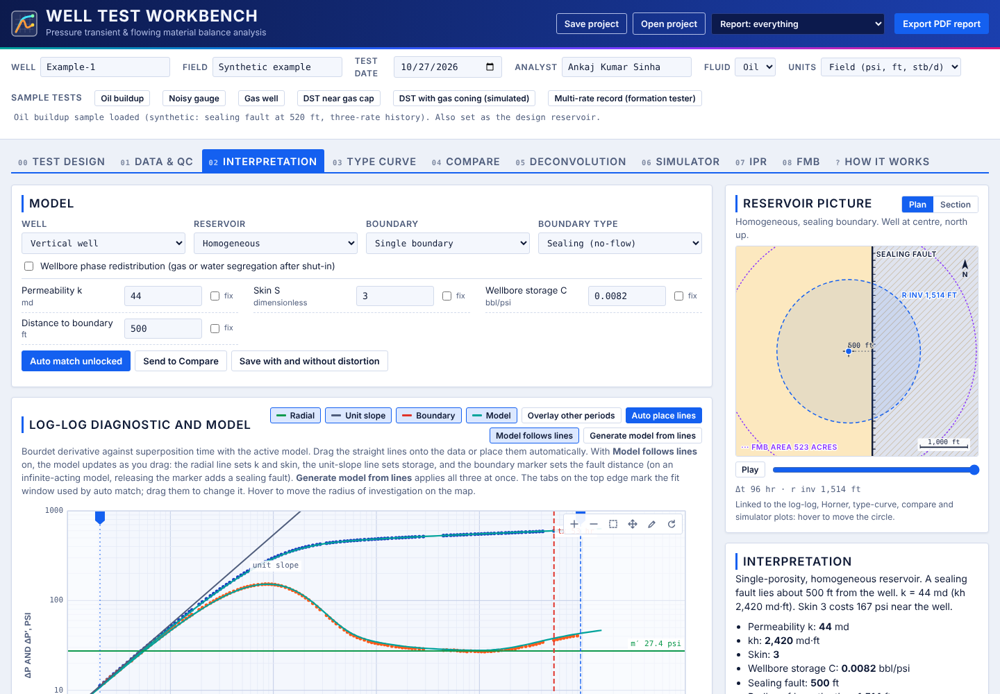
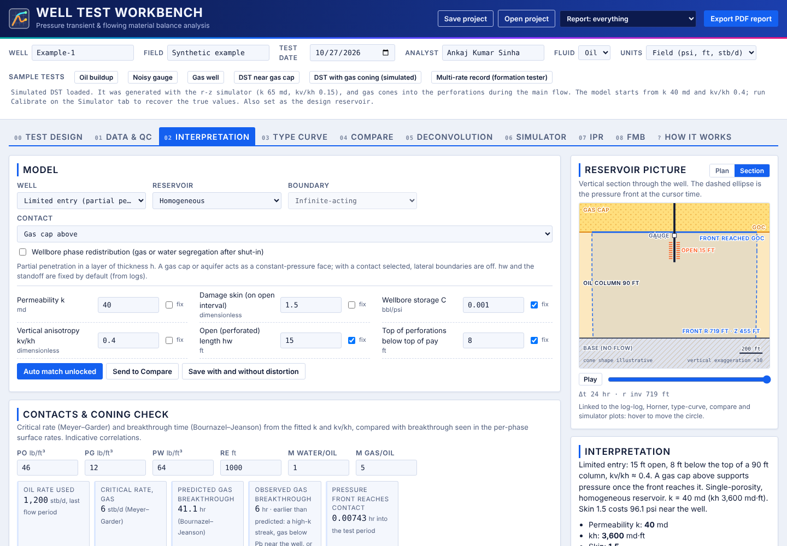
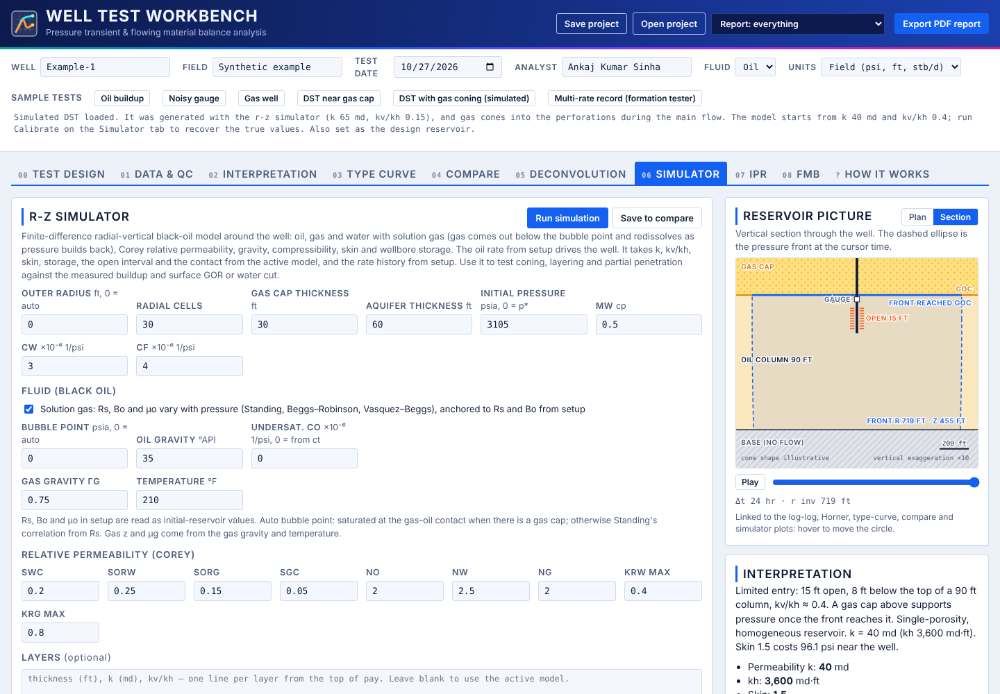

# Well Test Workbench

**Pressure transient analysis and flowing material balance in the browser.**
Developed by **Ankaj Kumar Sinha** · v1.0

▶ **Use it online:** **[authorankaj-glitch.github.io/well-test-workbench](https://authorankaj-glitch.github.io/well-test-workbench/)**

Well Test Workbench is a single-page tool for interpreting well tests, from data QC through to a model match and a report. It also includes checks built for DST-style tests near fluid contacts. There's nothing to install, and your data stays in your browser: nothing is uploaded anywhere.



## What it does

| Tab | What you get |
|---|---|
| **Test design** | Plan flow and buildup sequences from reservoir and fluid data, using its own reservoir model, separate from the interpretation |
| **Data & QC** | Gauge import with header detection (LAS-style channels such as `ETIM.hr`, `QGPR.psia`), column and unit confirmation, filtering, averaging, and period picking on linked pressure and rate plots |
| **Interpretation** | Bourdet derivative, straight-line tools, analytical model match with auto-match, and a linked reservoir picture in plan or section view |
| **Type curve / Compare** | Type-curve matching, and side-by-side comparison of periods or models |
| **Deconvolution** | Combined response across the rate history |
| **Simulator** | 2D radial-vertical (r-z) black-oil simulator with solution gas and automatic calibration of k and kv/kh |
| **IPR** | Deliverability from multi-rate data |
| **FMB** | Flowing material balance |

**Models:** vertical, fractured (infinite conductivity or uniform flux) and limited-entry wells; homogeneous, dual-porosity and radial composite reservoirs; infinite-acting, single fault, parallel channel and closed rectangle boundaries. Solved in Laplace space with Stehfest inversion, with multi-rate superposition. Gas wells are handled with normalized pseudo-pressure.

**Near-contact tests:** gas cap and aquifer contacts, per-phase rates (Perrine), wellbore phase-redistribution correction, and a coning consistency check that compares critical rate and breakthrough time with the observed surface GOR and water cut.

**Output:** save and reopen a project as `.json`, and export a PDF report. Field and metric units are supported, for oil and gas.

<p>


</p>

## Getting started

1. Open the tool, online or by downloading this repo and opening `index.html` in a browser.
2. Click one of the **Sample tests** (Oil buildup, Gas well, DST with gas coning, …) to see a full worked example.
3. To try your own file format, import [`examples/synthetic_buildup.txt`](examples/synthetic_buildup.txt) on the **Data & QC** tab.

All sample data is synthetic.

## Project structure

```
index.html            the whole application (HTML, CSS, JavaScript)
vendor/               jsPDF 2.5.1 for PDF reports (MIT, see vendor/jspdf-LICENSE.txt)
examples/             synthetic gauge file for trying the importer
docs/screenshots/     images used in this README
```

## License

Copyright © 2026 Ankaj Kumar Sinha.
Released under the **[PolyForm Noncommercial License 1.0.0](LICENSE)**.

In plain terms (the LICENSE text is what governs):

- **Free** for personal use, study, research and teaching, and for non-commercial organizations such as universities, charities, public research bodies and government institutions.
- **Commercial use needs a separate license.** That includes use by operators, service companies or consultancies in their business, and selling, bundling or offering the tool as a service.
- Copies and modified versions must keep the license and the copyright notice.
- Provided as-is, with no warranty. Engineering decisions remain the user's responsibility.

**For commercial licensing, contact author.ankaj@gmail.com.**

### Third-party components

The PolyForm license covers Well Test Workbench itself. The bundled PDF library, [jsPDF](https://github.com/parallax/jsPDF) 2.5.1 in `vendor/`, is the work of its own authors and remains under its own MIT license ([`vendor/jspdf-LICENSE.txt`](vendor/jspdf-LICENSE.txt)).
